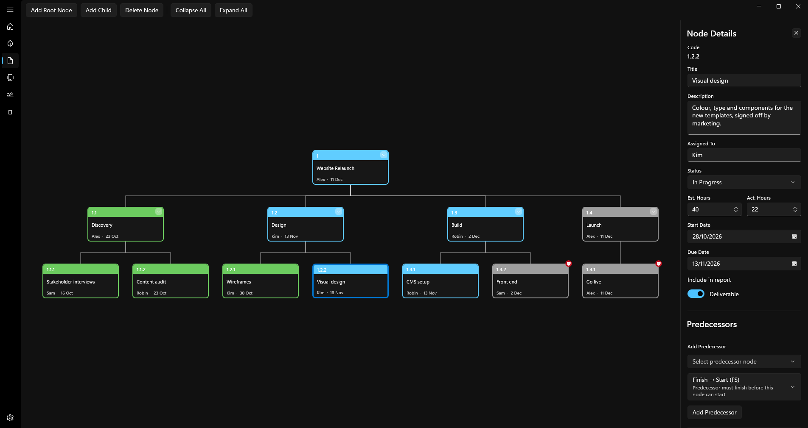

# iscWBS

[](https://github.com/iiisc/iscWBS/actions/workflows/ci.yml)
[](https://github.com/iiisc/iscWBS/releases/latest)
[](LICENSE)

Work Breakdown Structure planning for Windows. Break a project down, track status, hours and dependencies, and report progress.



## Features

- **WBS Tree and Outline**: diagram and list views with automatic codes, status, hour estimates and dependencies
- **Gantt**, **Dashboard** and **PDF reports** (beta): timeline, KPIs and status reports
- **Milestones** linked to WBS nodes
- English and Swedish, light and dark mode, keyboard shortcuts

## Install

Download `iscWBS-v<version>-win-x64.zip` from [Releases](https://github.com/iiisc/iscWBS/releases/latest), extract it to a folder you can write to (not `Program Files`) and run `iscWBS\iscWBS.exe`.

- Windows 10 1809 or later, x64. No installer, admin rights or .NET runtime needed.
- Updates install from **Settings → Software Updates**, after the download is checked against the SHA-256 checksum GitHub publishes.
- The executable isn't code-signed yet, so SmartScreen may warn on first launch.

## Data and privacy

Each project is a single `.iscwbs` file (SQLite) saved wherever you choose. Settings and logs stay in `%LOCALAPPDATA%\ISC\iscWBS`, and logs are deleted after 30 days. The app connects to the internet only when you check for updates, and then only to GitHub.

## Development

```powershell
dotnet build iscWBS.csproj
dotnet test tests/iscWBS.Tests
```

Requires the .NET 10 SDK. Publishing compiles with Native AOT, which also needs Visual Studio's C++ build tools. To release, run **Actions → Release**; it creates a draft release to review and publish.

## License

[MIT](LICENSE). Report security issues privately as described in [SECURITY.md](SECURITY.md).
